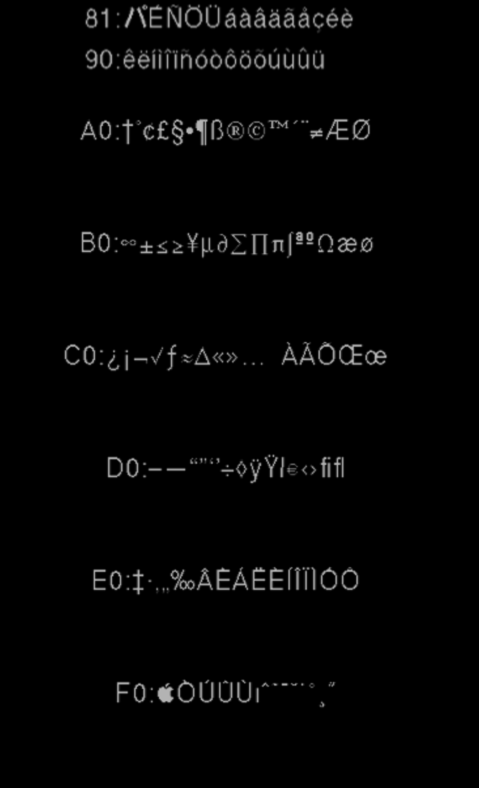

# Патч исполняемого файла: однобайтовые символы 0x82–0xFF (этап 4)

**Статус: работает, проверено в PCSX2 (24.10.2026).** Коды 0x82–0xFF выводятся глифами основного
шрифта, `81 xx` — по-прежнему кана/значки кнопок, `80 7C` — перенос строки. Скриншот:
[charset_test_patched2.png](img/charset_test_patched2.png).



## Как устроен SLUS_209.15

- ELF с одним сегментом по адресу 0x800000: заглушка-распаковщик (точка входа 0x851508) + поток zlib.
- `0x800004…0x8503A4` — сжатый образ кода (zlib, 0x503A0 байт; заглушка читает 0x503A4).
- `0x8503A4` — адрес распаковки (0x100000), `0x8503A8` — точка входа игры (0x100024).
  **Эти два слова нельзя затирать** (первая сборка так и сломалась — чёрный экран).
- Распакованный код: 1 069 700 байт с адреса 0x100000 (совпадает с дампом памяти PCSX2).

## Что было

Разбор текста в модуле шрифта (0x11E000–0x11FA00), 14 копий одного фрагмента:

```
c = *p
if c == 0x1F:      code = 0x8000 | (p[1] + 0x7F); p += 2     ; экранирование → верхняя половина шрифта
elif (signed)c < 0: code = c << 8 | p[1];         p += 2     ; любой байт ≥ 0x80 — двухбайтовый код
else:              code = 0x8000 | c;             p += 1
```

Коды `0x80xx` рисуются из основного шрифта (глиф xx), `0x81xx`–`0x83xx` — из блока каны,
`0x84xx`+ — из подгружаемых страниц кандзи (в US-версии не используются в субтитрах).

## Что стало

Условие «байт ≥ 0x80» заменено на «байт − 0x80 < 2 (беззнаково)», т. е. двухбайтовыми остаются
только 0x80 и 0x81. Каждая копия переписана на месте, без нового кода:

| Вид | Адреса | Суть |
|---|---|---|
| A (`bltzl t6`) | 0x11EC00, 0x11EDDC, 0x11F798, 0x11F998 | флаг считается в слотах `sll`/`sra` перед переходом |
| B (`sra t7; bltzl t7`) | 0x11F408, 0x11F430, 0x11F5F4, 0x11F67C, 0x11F7D0, 0x11F85C, 0x11F96C, 0x11F9D8 | 10 инструкций переставлены, флаг в свободном регистре |
| C (`bgez`, просмотр вперёд) | 0x11F3C0 (+ слот задержки 0x11F36C), 0x11F49C | указатель не двигается, нужен только правильный код |

Особенность: в 0x11F5F4, 0x11F67C, 0x11F7D0 указатель-база и результат — один регистр (`a1`),
второй байт читается со смещением 0.

Код сжимается обратно zlib уровня 9: 327 781 байт при месте 328 608. Размер ELF не меняется,
файл пишется в ISO на то же место (LBA 305).

## Изменение: двухбайтовые 0x80–0x8F

В строках GCX значки кнопок записаны двухбайтовыми кодами `83 xx` и `8C xx`. Поэтому условие
стало «байт − 0x80 < 0x10» (константа `LEADS` в `tools/exe_patch.py`): однобайтовые — 0x90–0xFF,
двухбайтовые — 0x80–0x8F. Единственный русский символ из этого диапазона («…», 0x85) перенесён
на 0x9F.

## Дополнительно: граница отрисовки

Функция отрисовки глифа (0x11E5C0) пропускала коды с младшим байтом 0, 0xFE, 0xFF
(`addiu t7,a0,-1; sltiu t7,t7,0xFD`). Граница поднята до 0xFF — иначе пропадали «ю» и «я».

## Побочный эффект

PCSX2 определяет игру по CRC исполняемого файла: было `AA31B5BF`, стало `6070748D`.
Встроенные в эмулятор исправления для MGS3 к изменённому файлу могут не применяться — для
эмулятора это можно поправить позже (копия записи GameDB или настройки игры). На PS2 не влияет.

## Инструменты

```
python -E tools/exe_patch.py work/ps2/SLUS_209.15 work/ps2/SLUS_209.15.patched [ISO]
```

Скрипт проверяет каждую исходную инструкцию перед заменой и откажется работать на другой версии
файла. Вспомогательные: `p2s_extract.py` (дамп памяти из сохранения PCSX2), `disasm.py`,
`xref.py`, `find_imm.py`, `branch_sources.py`, `find_decoders.py`.
